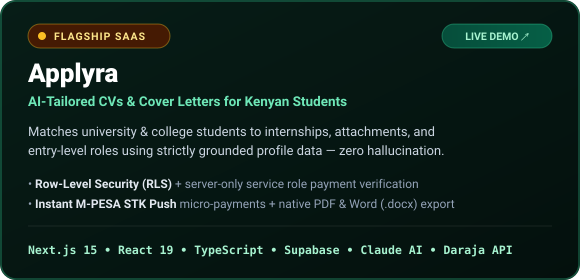
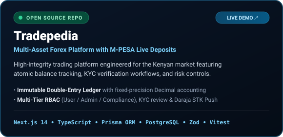

  

   

  

    
    
    
    
  

---

## ⚡ Engineering Profile

I am a **Full-Stack TypeScript Engineer** based in **Eldoret, Kenya**, focused on building resilient, production-grade web applications tailored for East African users and global standards. My work sits at the intersection of **Modern Web Architecture (Next.js / React / TypeScript)**, **FinTech Payment Infrastructure (Safaricom Daraja M-PESA & Double-Entry Ledgers)**, and **Applied AI Systems (Anthropic Claude API)**.

- 🏗️ **End-to-End Product Ownership:** From relational schema design (`PostgreSQL`, `Prisma`, `Supabase RLS`) and cryptographic auth (`JWT`, `RBAC`) to responsive interfaces (`Tailwind CSS`, `shadcn/ui`).
- 💳 **FinTech & Local Payments:** Experienced in integrating **Safaricom Daraja 2.0 (M-PESA Express STK Push)**, asynchronous webhook callbacks, and immutable double-entry accounting ledgers.
- 🤖 **Grounded AI Engineering:** Building reliable LLM pipelines with strict schema validation (`Zod`), server-only secret isolation, and zero-hallucination document generation (`PDF` / `DOCX`).

---

## 🚀 Featured Production Systems

  
  

### 1. [Applyra](https://applyra-five.vercel.app) — AI Career Platform for Kenyan Students
> **Apply smarter. Get seen.** Applyra helps university and college students across Kenya generate tailored, recruiter-ready CVs and cover letters for internships, industrial attachments, and entry-level roles in seconds.

| Pillar | Architectural Implementation |
| :--- | :--- |
| **🎯 Zero-Hallucination AI Tailoring** | Uses **Anthropic Claude API** with strict prompt grounding so generated CVs and cover letters map exclusively to the student's verified profile data. |
| **🔒 Defense-in-Depth Security** | **Row-Level Security (RLS)** enforced across every Supabase table; `payments`, `generated_documents`, and `audit_logs` are restricted to server-only service-role mutations (`server-only`). |
| **📲 Instant M-PESA Checkout** | Integrated **Safaricom Daraja STK Push** allowing students to unlock document generations seamlessly from their phones. |
| **📄 Native Document Engine** | Parses uploaded resumes (`unpdf`, `mammoth`) and compiles ATS-friendly **PDF** (`@react-pdf/renderer`) and **Word** (`docx`) files on demand. |

---

### 2. [Tradepedia](https://github.com/R9291/tradepedia) — Multi-Asset Trading Platform & Financial Ledger ([Live Demo](https://tradepedia-opal.vercel.app))
> A high-integrity online forex and multi-asset trading platform engineered for the Kenyan market, complete with live **M-PESA STK Push deposits**, **KYC compliance workflows**, and an **immutable double-entry ledger**.

| Pillar | Architectural Implementation |
| :--- | :--- |
| **📒 Immutable Double-Entry Ledger** | Every balance mutation writes an atomic, append-only `LedgerEntry` using fixed-precision `Decimal` arithmetic in **PostgreSQL + Prisma ORM**—direct balance edits are impossible by design. |
| **🛡️ Multi-Tier RBAC & KYC** | Role-based access control across `USER`, `ADMIN`, and `COMPLIANCE` roles, with end-to-end KYC identity verification (National ID, Passport, Selfie) and mandatory audit logging. |
| **💸 Daraja 2.0 M-PESA Express** | Real-time STK Push deposit initiation and asynchronous callback reconciliation with regulatory `DEMO_MODE` support aligned with CMA guidelines. |
| **📈 Interactive Market Terminal** | Built with **Next.js 14 (App Router)**, **TradingView Lightweight Charts**, `jose` HTTP-only JWT sessions, `Zod` schema validation, and **Vitest** automated testing. |

---

## 🛠️ Technical Stack & Tooling

<table>
  <tr>
    <td width="25%"><b>Frontend & UI</b></td>
    <td>
      
      
      
      
      
    </td>
  </tr>
  <tr>
    <td><b>Backend & Database</b></td>
    <td>
      
      
      
      
      
    </td>
  </tr>
  <tr>
    <td><b>FinTech & AI Integrations</b></td>
    <td>
      
      
      
      
    </td>
  </tr>
  <tr>
    <td><b>DevOps, Testing & Workflow</b></td>
    <td>
      
      
      
    </td>
  </tr>
</table>

---

## 🏛️ Engineering Principles I Build By

1. **Financial & Data Integrity First:** Payment and balance state changes must be idempotent, server-verified, and backed by append-only audit trails (`LedgerEntry` / `audit_logs`).
2. **Strict Boundary Security:** Client bundles never touch privileged credentials (`server-only`), every database table enforces **Row-Level Security (RLS)** or strict **RBAC**, and every external payload is validated at the edge with **Zod**.
3. **Practical Local Impact:** Designing software that works effortlessly with East African payment rails (**M-PESA STK Push**) and solves high-leverage problems for students, traders, and businesses.

---

## 🤝 Let's Connect & Build

I am open to **Full-Stack Software Engineering roles**, **contract/consulting engagements**, and **collaborations** on FinTech or AI products.

- 📬 **Email:** [kimutaieugine178@gmail.com](mailto:kimutaieugine178@gmail.com)
- 🌐 **Live Products:** [Applyra](https://applyra-five.vercel.app) • [Tradepedia](https://tradepedia-opal.vercel.app)
- 📍 **Base:** Eldoret, Kenya (Available for Remote & Hybrid roles)
